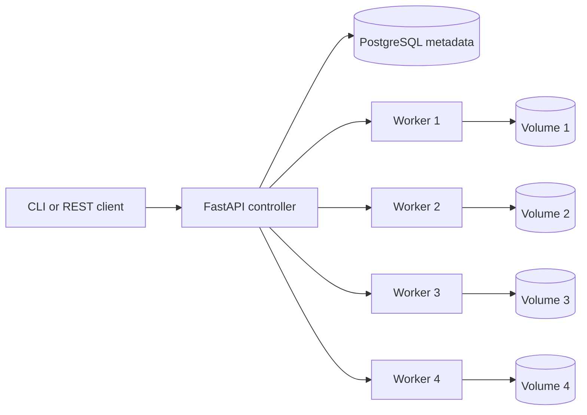

# Mini Distributed Cloud Object Store

A local distributed object store built with Python, FastAPI, PostgreSQL, and Docker Compose. One controller coordinates four persistent storage workers. Files are split into 1,000,000-byte chunks, with two copies of every chunk placed on different workers.

The project includes a REST API, command-line client, automated tests, and a guided demonstration of worker failure and data corruption. It is designed for a single-host coursework deployment.

## At a glance

| | Implementation |
| --- | --- |
| Topology | 1 controller, 4 workers, 1 PostgreSQL service |
| Object data | Arbitrary binary files in persistent worker volumes |
| Metadata | PostgreSQL records plus custom string key-value pairs |
| Chunking | 1,000,000 bytes per chunk; final chunk may be smaller |
| Replication | 2 checksum-verified copies on distinct workers |
| Recovery | Heartbeats, reconciliation, durable repair jobs, local integrity scans |
| Client access | REST API and `store` CLI |



The controller is the only client-facing service. Worker and database ports stay inside the Compose network. See [the design document](docs/design.md) for the storage model and recovery protocol.

## Requirements

- Docker Engine with Docker Compose.
- Python 3.12 or newer for the local CLI, tests, and guided demo.
- A free localhost port 8000 and unused container names `worker1` through `worker4`.

The service and tests target Linux containers. The shell launcher `./store` targets Unix-like shells; Windows commands are shown below.

## Quick start

From the repository root:

```bash
docker compose up -d --build --wait
docker compose ps
curl http://127.0.0.1:8000/api/v1/status
```

The first command builds the image, runs database migrations, and starts all six services. Wait until the controller and four workers are healthy. The API is at `http://127.0.0.1:8000`; interactive API documentation is at `http://127.0.0.1:8000/docs`.

Install the local client and demo dependencies:

```bash
python3 -m venv .venv
.venv/bin/python -m pip install -r requirements-dev.txt
```

On Windows PowerShell:

```powershell
py -3.12 -m venv .venv
.\.venv\Scripts\python.exe -m pip install -r requirements-dev.txt
$env:PYTHONIOENCODING = 'utf-8'
```

The UTF-8 setting lets the guided demo print its Unicode status symbols in a Windows terminal. The server itself runs in Linux containers.

## Try the client

```bash
./store upload report.pdf --meta owner=student --idempotency-key report-001
./store list
./store metadata OBJECT_ID
./store placements OBJECT_ID
./store download OBJECT_ID -o downloaded.pdf
./store patch OBJECT_ID --meta owner=updated
./store status
./store delete OBJECT_ID
```

Replace `report.pdf` with your file and `OBJECT_ID` with the UUID returned by upload. On Windows, replace `./store` with `.\.venv\Scripts\python.exe -m object_store.cli`. Downloads are checked against the stored size and SHA-256 before the destination file is published. Use `--force` only when you intend to replace an existing destination.

See [the CLI guide](docs/cli.md) for every command, JSON output, inspection tools, and safe retry behavior.

## Client API

| Method | Path | Purpose |
| --- | --- | --- |
| `POST` | `/api/v1/objects` | Upload multipart `file` and optional JSON `metadata`; returns 201 |
| `GET` | `/api/v1/objects/{object_id}` | Download the original binary object |
| `GET` | `/api/v1/objects/{object_id}/metadata` | Read system and custom metadata |
| `PATCH` | `/api/v1/objects/{object_id}/metadata` | Merge custom metadata without re-uploading |
| `DELETE` | `/api/v1/objects/{object_id}` | Hide the object immediately and return 204. Background cleanup removes stored copies when workers are available. |
| `GET` | `/api/v1/objects` | List objects with `offset` and `limit` |
| `GET` | `/api/v1/status` | Inspect workers, scan progress, cleanup, and repairs |

Upload example:

```bash
curl -sS -X POST http://127.0.0.1:8000/api/v1/objects \
  -F 'file=@report.pdf;type=application/pdf' \
  -F 'metadata={"owner":"student","course":"cloud"}'
```

The response includes the object ID, whole-object checksum, ordered chunks, and replica locations. API errors use a JSON `error.message`. The optional `Idempotency-Key` header makes a retry of the *same* upload return the original 201 result. A different payload with the same key returns 409; a matching retry after deletion returns 410.

## Run the demonstration

From the repository root, start the cluster and launch the guided demo:

```bash
docker compose up -d --build --wait
.venv/bin/python final_demo/demo.py
```

Press Enter at each stage. A successful run ends with `ALL DEMO STAGES PASSED`. It verifies the six-container deployment, binary round trip, chunk distribution and physical copies, metadata, `worker2` stop/restart, intentional corruption and repair, upload replay across a controller restart, and final cleanup. It announces each fault command before running it and restores the affected services. Its default object is 100 MB plus a 19-byte final chunk.

For a quick unattended rehearsal:

```bash
.venv/bin/python final_demo/demo.py --unattended --size-mb 2
```

On Windows PowerShell, run `.\.venv\Scripts\python.exe final_demo\demo.py --unattended --size-mb 2` after setting `PYTHONIOENCODING` as shown above. Run the demo on an otherwise idle local cluster: stopping a worker or the controller temporarily affects all objects, although the demo only corrupts and deletes its own test data.

## Tests

Run the automated suite in Linux, where the worker's durable filesystem operations are supported:

```bash
.venv/bin/python -m pytest -q
```

The suite covers chunk boundaries, API behavior, worker membership, concurrent lifecycle operations, interrupted writes, integrity scanning, repair, CLI behavior, and upload idempotency. A native Windows run is not supported because the worker uses Linux directory `fsync` semantics. Docker is the intended runtime.

On Windows PowerShell, run the suite inside the built Linux image:

```powershell
$repo = (Get-Location).Path
docker run --rm -v "${repo}:/app" -w /app mini-object-store:local sh -c 'pip install -q -r requirements-dev.txt && pytest -q'
```

## Stop and retain data

```bash
docker compose stop
docker compose start
```

`docker compose down` removes containers and the network while retaining named volumes. A later `docker compose up -d --wait` reuses the stored data. `docker compose down -v` deletes the volumes and stored objects permanently.

## Scope and limitations

This deployment runs one controller process and one process per worker volume. Process-local locks and a single PostgreSQL instance are intentional. Worker replication does not protect against loss of the host, its disk, or the metadata database. Authentication, TLS, controller/database high availability, backups, and resumable transfers are not included. See [design and limitations](docs/design.md#operational-boundaries) for details.
