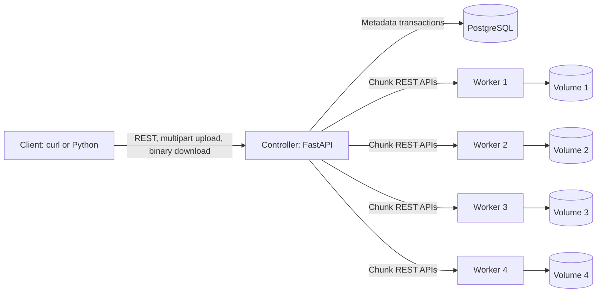

# Backend architecture and implemented contract

This is the finalized baseline for the local coursework deployment. The implementation follows this design; limitations are explicit below.

## Architecture and ownership



- Exactly one controller process owns all metadata and coordinates placement, reads, cleanup, and repair. Run one Uvicorn process; in-process object locks are intentionally sufficient only for this topology.
- Four containers run the same worker code. Workers own chunk files and checksum manifests, and register/heartbeat to the controller. A worker does not access PostgreSQL.
- PostgreSQL stores metadata, never object bytes. Its Docker volume survives container recreation.
- Six long-running containers: controller, four workers, and PostgreSQL. No Kubernetes, external cloud service, broker, gRPC, or leader-election service.
- Only controller port 8000 is published, on loopback. Worker URLs are a fixed membership allowlist, preventing arbitrary registration destinations. Internal endpoints are intended for a trusted local Compose network, not a public multi-tenant deployment.
- Default local database credentials are development credentials. Authentication, TLS termination, authorization, backups, controller HA, and Internet deployment are outside the submission baseline.

## Storage invariants

1. A chunk is at most **1,000,000 bytes**, interpreting MB as decimal. A final chunk may be smaller. Empty objects have zero chunks and SHA-256 of empty bytes.
2. Object IDs and chunk IDs are independent UUID4 values. Original names are display metadata, never paths. Duplicate object names are allowed.
3. Chunk positions are zero-based and unique within an object. Bytes are reassembled in position order.
4. Normal operation targets exactly two valid replicas on distinct workers. A repair may temporarily create extra replicas; unavailable old replicas remain recorded until removable.
5. Upload returns 201 only after each chunk has received two successful durable storage acknowledgments. This is an acknowledgment guarantee, not a promise that failures cannot occur immediately afterward.
6. Controller SHA-256 values are authoritative. Workers validate local manifest structure, integer size in 1..1,000,000, lowercase 64-hex SHA-256, and a 4,096-byte manifest limit before verifying bytes. The controller independently verifies bytes against its own checksum before returning them; an altered file with a matching altered worker manifest is still rejected. Detected missing/invalid replicas are logged with object/chunk/worker identifiers.
7. No partial object is visible through list, download, or metadata APIs.
8. A storage operation's target is committed to the database before sending bytes. Lost replies leave discoverable cleanup/repair work.
9. Never trim surplus replicas until two current copies have been read and verified.

## Relational model

| Table | Key and fields | Purpose and constraints |
|---|---|---|
| `objects` | UUID `id`; `name`, `size`, `content_type`, UTC `created_at`/`modified_at`, SHA-256 `checksum`, `chunk_count`, JSON `custom_metadata`, `state` | State is `uploading`, `available`, or `deleting`. JSON is a PostgreSQL relational-table column, not another database. |
| `workers` | Service `id`; unique `url` and nullable unique `storage_id`; `boot_id`, `eligible`, `membership_version`, `last_seen`, `free_bytes` | Controller timestamps heartbeats. Availability requires completed reconciliation and a fresh heartbeat. Free space is advisory, not a reservation. |
| `chunks` | UUID `id`; FK `object_id`, `position`, `size`, `checksum` | Unique `(object_id, position)`; size in 1..1,000,000. |
| `replicas` | Composite PK `(chunk_id, worker_id)`; FKs; `state` | `pending` (write intent or currently unverified copy), `healthy` (last verified/acknowledged), or `bad` (proven missing/corrupt); row existence also records a potential physical copy after a lost response. |

An Alembic migration creates the schema. Explicit deletion order is replicas, chunks, then objects. Pending work is represented by lifecycle and replica rows, so a separate broker/job table is unnecessary. Metadata PATCH merges a copied dictionary under the object lock, preserving unrelated keys.

## Public REST API

All errors before streaming begins use `{"error":{"message":"..."}}`; validation errors may add `details`. Invalid inputs use 400, missing/invisible objects 404, unavailable storage/database 503, unexpected failures 500. IDs must be valid UUID strings; malformed IDs use 400. Client object bytes are immutable after creation.

| Method and path | Request | Successful result |
|---|---|---|
| `POST /api/v1/objects` | `multipart/form-data`; required binary `file`; optional `metadata` field containing a JSON string-to-string object | 201; full object metadata including chunks and replica locations |
| `GET /api/v1/objects/{object_id}` | None | 200; original binary bytes, stored Content-Type, Content-Length, attachment filename, `X-Object-Checksum` |
| `GET /api/v1/objects/{object_id}/metadata` | None | 200; object/system/custom metadata and chunk locations |
| `PATCH /api/v1/objects/{object_id}/metadata` | JSON string-to-string map | 200; updated full metadata. Adds/replaces custom keys; does not remove keys or modify stored bytes. |
| `DELETE /api/v1/objects/{object_id}` | None | 204 after committing logical deletion; physical cleanup is asynchronous |
| `GET /api/v1/objects?offset=0&limit=100` | Offset >=0, limit 1..1000 | 200; `{objects: [...], offset, limit}`; each item has object_id, name, size, content_type |
| `GET /api/v1/status` | None | 200; worker availability/last_seen/free_bytes, pending cleanup count, replication factor |
| `GET /health` | None | 200 when controller can query PostgreSQL; otherwise 503 |

Metadata rules: at most 100 keys, each 1..128 characters, string values up to 2048 characters. Names are at most 255 characters and stripped of path prefixes. Missing Content-Type defaults to application/octet-stream. The multipart parser permits one file and one ordinary field. No arbitrary 100 MB or 500 MB application limit is imposed; disk capacity is the practical bound.

Metadata response example (abbreviated):

```json
{
  "object_id": "55ec264b-06a2-4414-9583-48058f2beab1",
  "name": "demo.bin",
  "size": 1000001,
  "content_type": "application/octet-stream",
  "created_at": "2026-11-13T12:00:00+00:00",
  "modified_at": "2026-11-13T12:00:00+00:00",
  "checksum": "<whole-object SHA-256>",
  "chunk_count": 2,
  "chunk_size": 1000000,
  "metadata": {"owner": "student"},
  "chunks": [{
    "chunk_id": "09778879-b8c5-46b2-89ab-92aa9e188ae6",
    "position": 0,
    "size": 1000000,
    "checksum": "<chunk SHA-256>",
    "replicas": [
      {"worker_id": "worker1", "state": "healthy", "available": true},
      {"worker_id": "worker2", "state": "healthy", "available": true}
    ]
  }]
}
```

`healthy` means last known checksum-valid/acknowledged; `available` means reconciled and heartbeat-fresh. Neither is a real-time proof of disk integrity; reads and background scrubbing perform that verification.

## Internal REST API

| Receiver | Method/path | Contract |
|---|---|---|
| Controller | `POST /internal/workers/register` | `{worker_id, storage_id, boot_id, url, free_bytes}` matching configured membership; 200 acknowledgment |
| Controller | `POST /internal/workers/heartbeat` | Same body; 200 with eligibility; unknown worker or new boot receives 404 and registers next |
| Worker | `PUT /internal/chunks/{chunk_id}` | Raw bytes plus `X-Chunk-Checksum`; 200 `{chunk_id, checksum, size}` after durable write |
| Worker | `GET /internal/chunks/{chunk_id}` | 200 binary plus `X-Chunk-Checksum`; 404 missing, 409 corrupt/incomplete |
| Worker | `DELETE /internal/chunks/{chunk_id}` | 204 even when absent. `X-Delete-Permanent: true` durably marks final deletion and rejects future PUTs with 409; ordinary repair/surplus removal omits it. |
| Worker | `GET /internal/workers/{worker_id}/chunks` | 200 inventory with storage/boot IDs, chunk IDs and validity, hashes and sizes for valid files; 404 for another worker identity |
| Worker | `GET /health` | 200 service/storage/boot identity and process status; not eligibility |
| Worker | `GET /ready` | 200 after recent controller-confirmed eligibility; otherwise 503 |

PUT with the same ID/content is repeatable. Different content under an existing ID is 409. Repair of a corrupt manifest first deletes that replica, while holding verified replacement bytes obtained from a valid source, then stores the expected bytes. Public POST has no idempotency-key facility: retrying after a lost 201 may create another complete object. Repeated public DELETE returns 404 after the first succeeds, but does not change the final state; this remains idempotent behavior.

## Lifecycle and request flows

### Upload

1. Bound concurrent multipart ingestion to two requests, check upload-spool free space, parse and validate metadata/file.
2. Require two reconciled, heartbeat-fresh workers. Create an invisible `uploading` object and hold its lock.
3. Read at most 1 MB from the spooled upload, update whole-object SHA-256, and persist the chunk description.
4. Choose workers by fewest recorded replicas, with stable worker-ID tie breaking. Skip unavailable workers and those reporting less than chunk size + 10 MB free. Distinct workers only.
5. Commit a `pending` replica destination before each PUT. Worker writes a temporary file, flushes/fsyncs it, atomically renames, and fsyncs the directory; does the same for its manifest before acknowledgment.
6. Mark each matching acknowledgment `healthy`. Try other workers if a candidate fails. After every chunk has two acknowledgments, publish `available` with final size/count/hash in one transaction.
7. On failure or cancellation mark `deleting`; periodic cleanup removes every recorded target. If the database itself is unavailable, preserve the original upload failure and leave the `uploading` intent. Once its object lock is released, maintenance converts it to `deleting` when the database recovers; startup recovery also handles it after restart. Active uploads hold their lock throughout and are never reclaimed.

Worker data files are `/data/<uuid>.chunk` and `/data/<uuid>.json`. Final deletion adds an empty, fsynced `/data/<uuid>.deleted` marker before removing those data files. Workers reject PUT/GET for a marked ID; startup finishes removal of data left behind after a marked deletion was interrupted. The marker survives restart and is not exposed as a stored chunk in inventory. Uncommitted `*.tmp` files are removed on worker startup. There is no deduplication or overwrite of object content.

### Download

1. Acquire a download slot (four maximum) and object lock. Load only an available object and ordered chunk metadata.
2. Fetch and verify the first chunk before starting the response, allowing a clean 503 if immediately unrecoverable.
3. For each subsequent chunk try healthy eligible/fresh candidates first, then other eligible/fresh recorded copies. Expired and unreconciled workers are excluded. Validate size and controller checksum before yielding bytes.
4. Mark proven corrupt/missing copies bad; background repair follows. Network failure alone does not prove corruption.
5. Release the lock/slot on success, exception, or client disconnect. If a later chunk is unrecoverable, terminate the stream; its already-sent 200 cannot become a JSON 503. Content-Length and final SHA-256 allow clients to reject incomplete downloads.

The complete object is never assembled in memory or a download temporary file. Chunk metadata scales with chunk count. Each stream's bytes are bounded to chunk buffers rather than object size.

### Metadata update and deletion

PATCH and DELETE serialize with uploads, downloads, and maintenance for the same object. An already-running download finishes or disconnects before DELETE acquires the lock. Once DELETE commits and returns 204, new requests see 404; existing bytes on offline workers are tracked until physical removal. Thus “immediate logical deletion” applies at the deletion commit, not at request arrival while a download holds the lock.

Cleanup records destinations for every registered worker and sends idempotent permanent DELETE calls to available workers. Covering all workers prevents a delayed PUT from recreating a copy whose earlier surplus-location record was removed. Unavailable workers retain durable records; each pass may re-confirm deletion on already-cleaned workers until all workers acknowledge. Rows are removed only after acknowledged deletion; no object row is removed while any chunk/replica cleanup remains. Worker return cannot republish a deleted object.

A final DELETE persists its marker before unlinking bytes. If disk exhaustion prevents the marker write, it fails with 503 and the controller retains cleanup work until storage recovers. Repair deletes are non-permanent so valid bytes can be restored under the same chunk ID. Empty `.deleted` markers contain no object content but consume filesystem metadata/inodes. They are deliberately retained indefinitely in this bounded coursework system; safe garbage collection would require a bound on late requests or a stronger request-generation protocol.

## Failure, repair, and restart policy

- Worker heartbeat interval: 2 seconds. Each worker explicitly registers on process startup, then sends heartbeats. Controller declares a worker unavailable after 10 seconds without a heartbeat. Explicit re-registration, or a heartbeat following expiry, changes its previously healthy replicas to pending verification. Normal timely heartbeats preserve verified state. These timing values are configurable.
- HTTP connect timeout: 2 seconds; other per-operation timeout: 5 seconds; one retry after 0.1 seconds for network/server failures. A timeout can be ambiguous, hence durable destination intents.
- Maintenance runs, then sleeps 3 seconds. Intervals are not hard recovery deadlines: work and timeouts extend a pass.
- Each pass re-reads lifecycle state under the object lock, reclaims inactive `uploading` intents, inspects available objects for insufficient live healthy replicas, and cleans deleting objects. Busy objects are skipped to avoid conflicting writes/deletes.
- Periodic integrity checks now run on each worker over at most 16 cataloged chunks per pass with persisted cursor/cycle boundaries. Each placement is checked independently against trusted expected values. The controller processes coalesced repair intents serially; repair/surplus verification may read additional chunks. A network timeout/server error leaves a copy pending verification (and never clears previously proven damage); only missing/corrupt responses or invalid returned bytes prove a bad copy. Reads performed before surplus removal also update the successful verification state.
- If fewer than two valid live copies remain, fetch a valid source and store replacements on distinct available workers. When no valid copy is reachable, log the failure, preserve evidence, retry later, and return 503 on reads that have not started.
- When workers return, explicit registration or a post-expiry heartbeat invalidates old healthy states to pending, so their retained copies must be verified before counting as healthy again. Pending/bad replicas are read; surplus deletion requires two verified copies. The controller obtains a complete checksum-verified inventory before eligibility. It compares entries with trusted chunk size/hash, marks missing or invalid recorded replicas bad, discovers matching extra copies, and permanently deletes unknown UUIDs. Deleting objects remain pending cleanup. It never replaces authoritative hashes with inventory values.
- On controller startup convert all `uploading` objects to `deleting`, then resume periodic cleanup/repair. Worker heartbeats reestablish freshness. Available objects and metadata survive controller/container restart.
- No guarantee against simultaneous loss/corruption of both copies, deletion of persistent volumes, host failure, or loss of the metadata database. Two containers on one physical disk provide process-failure isolation, not independent hardware durability.

## Concurrency and resource tradeoffs

Per-object asyncio locks serialize lifecycle operations in one controller process. A single maintenance lock prevents overlapping passes. Worker filesystem operations run in a thread pool and use a worker lock to serialize manifest/data transitions. Metadata uses small synchronous SQLAlchemy transactions (no database transaction is held across worker HTTP calls); database stalls can block the event loop briefly, so connection/pool waits are bounded. This is acceptable for the local baseline, not high-throughput production architecture.

Two simultaneous multipart uploads can each spool a complete incoming object to controller `/tmp`; this is disk spooling, not RAM buffering. A 50 MB free-space guard is checked during ingestion; actual write failures remain authoritative. Four downloads are admitted concurrently. Worker and controller network requests have finite concurrency. With roughly 5 GB available, use 100 MB routinely and 500 MB individually; do not retain many test objects. A 500 MB upload uses about 1 GB for two replicas plus source/spool and transient repair copies. Source generation in the demo uses one 1 MB block; downloads are hashed without saving another file.

This is a local teaching system. Full inventories and metadata/list responses are not optimized for millions of chunks, object-lock entries remain in process memory until restart, and long client streams can postpone deletion/repair for that object. No resumable/range downloads, user accounts, object versioning, content updates, or multipart-resume protocol are promised.

## Acceptance checklist and evidence mapping

| Requirement | Verification |
|---|---|
| Arbitrary bytes and original reconstruction | Binary boundary tests and SHA-256 round trips; 100/500 MB demo |
| Decimal chunk size and final partial chunk | 0, 1, C−1, C, C+1, 2C, 2C+1 and 2.5 MB tests (C = 1,000,000 bytes) |
| Two distinct replicas and worker distribution | Metadata assertions and demo checks across four workers |
| Metadata without re-upload | PATCH tests preserve object checksum; concurrent updates merge |
| Worker stop/restart | Demo uses `docker stop worker2` / `docker start worker2`; tests check repair and surplus cleanup |
| Corruption detection/recovery | Corrupt a demo chunk; verify download and actual repaired disk copies; tests also corrupt manifests |
| No valid replicas | 503 test for corruption of both copies |
| Persistent storage | Worker disk reopen test and live controller restart in fault demo |
| Interrupted upload and ambiguous replies | Cancellation, startup cleanup, lost-PUT-ack tests |
| Offline deletion | Retain cleanup across recovery, then remove data after worker returns |
| Storage unavailable | One-worker upload rejection and simulated ENOSPC tests |
| REST validation and retries | Invalid metadata/UUID/registration, PUT conflict, repeat DELETE tests |

Run commands and recorded results are in README.md and validation.md. Phase 1 is complete; subsequent implementation is present in the repository.

## Reliability upgrade Phase 1: membership contract

The selected design follows TEAM-PLAN cards A2/B3/A5: stable storage identity, fresh boot identity, inventory before eligibility, and safe excess-copy reconciliation. PostgreSQL and the existing service boundary remain in use.

`worker.identity` is atomically persisted and fsynced separately from chunk manifests; it binds the volume to the configured service name. Each app process gets a fresh boot UUID. Corrupt identity files fail startup instead of silently generating a replacement. Migration 0002 preserves existing objects and replica rows, adds membership fields, and makes legacy workers/replicas ineligible/pending until registration and inventory finish. Legacy worker volumes create their first storage UUID during upgrade.

Registration probes the configured worker health endpoint to reject delayed reports from an old boot. A different volume UUID for an already bound service is rejected and disables eligibility; automated volume replacement is outside this phase. Registration or heartbeat expiry advances a durable membership version and invalidates replica health. Heartbeats from a different boot must register. Maintenance retries reconciliation, checks object state under existing object locks, and only enables a worker when its boot and membership version still match. An inventory failure leaves it ineligible; database state survives controller restart. A final health probe detects a worker restart during inventory.

Controller chunk requests carry expected storage/boot headers; workers reject a mismatched incarnation, and replies from a superseded membership version are discarded. These are membership guards; per-operation sequencing and durable write receipts are implemented in upgrade Phase 2 below. Direct internal diagnostic calls may omit these headers on the trusted local Docker network.

Worker readiness requires a recent successful controller report confirming eligibility; loss of contact clears readiness. Compose uses `/ready` for workers and `/health` for the controller, avoiding a startup dependency cycle. Inventory is currently a full list and one checksum pass under the worker disk lock, with bounded chunk reads but metadata memory proportional to local chunk count. Large inventories may require longer request timeouts; routine integrity scanning is separate, bounded, persisted and worker-local as described below. Exactly one worker process may own each volume, and one controller process owns lifecycle coordination.

## Reliability upgrade Phase 2: durable integrity and repair

This follows TEAM-PLAN B2/B4/A5: a worker catalog with receipts, fixed-order local scans with persistent progress, retained/repeated damage reports, and a serial coalesced repair queue. Python's standard-library SQLite is added for worker-local relational state; PostgreSQL remains the authoritative object/membership database. No broker or additional container is introduced.

### Worker persistence and operation ordering

`catalog.sqlite` contains `chunks` (immutable expected hash/size, publication state and latest sequence), `operations` (latest sequence/signature/state/receipt per chunk), `damage` (one retained event per chunk/operation), and singleton `scan` progress. Transactions use SQLite `synchronous=FULL` and connections are closed per operation. Chunk files/manifests still use atomic rename and fsync. Local catalog corruption is a storage error, not permission to relearn expected hashes from data.

Controller migration 0003 adds a singleton `operation_clock`, latest `worker_operations` per worker/chunk, `repair_jobs`, `damage_receipts` and reported worker scan progress. Legacy workers become ineligible until authoritative expectations have been seeded through reconciliation, in batches of at most 100 entries. Expected values cannot change an existing catalog hash/size, and expectations older than a worker mutation are rejected.

Before each PUT/DELETE logical attempt the controller atomically allocates an increasing sequence and records its intent. Transport retries reuse that sequence. Worker requests use `X-Operation-Sequence`, in addition to storage/boot targeting. Before file changes, the worker commits sequence/signature/pending state; older sequences and same-sequence conflicting operations receive 409. A completed retry returns the stored receipt. Successful PUT acknowledgments are followed by an independent GET/hash/size check before a placement becomes healthy. Unsequenced internal mutations use sequence zero and cannot override a previously sequenced mutation; direct disk methods remain low-level local/test helpers.

After an interrupted PUT, startup completes publication only if the bounded staged/final file matches the operation's recorded expectation; otherwise it retains pending intent and reports damage. Interrupted DELETE is replayed before serving requests. A permanent tombstone is persisted before unlinking files and rejects even newer PUT sequences. On controller restart, durable queue/replica/object records drive retry or cleanup; new logical attempts supersede old mutation sequences, while inventory can resolve a valid pending PUT. Binary payloads are not stored in either database.

### Local scans and acknowledged reports

Every worker scans up to 16 active catalog records in UUID order, then sleeps `SCAN_INTERVAL` (default 3 seconds). It persists a cycle ceiling at the start of a sweep and advances the cursor after recording each check/report. Newly arriving IDs cannot indefinitely extend the current cycle. The cursor, ceiling, cumulative checked count and completed cycles survive restart. Missing files, invalid manifests and changed bytes are checked against the trusted catalog, including the case where bytes and manifest were changed consistently. Removed/deleted placements are excluded.

A damage event records chunk ID, operation sequence, reason and generated event UUID. Up to 100 retained events accompany each registration/heartbeat. The controller transaction deduplicates the event, checks its operation sequence against current placement intent, marks a current replica bad and enqueues/increments its repair revision. Only after commit does it return `acknowledged_damage`; the worker removes only those event IDs. Lost acknowledgments and restarts cause safe redelivery. Obsolete reports are acknowledged without damaging replacement health. Unrepaired corruption can generate a new event after acknowledgment on a subsequent scan.

### Serial repair and current-intent validation

`repair_jobs` has one row per chunk: revision, reason, attempts, last error and last-update timestamp. Read failures, inventory, local reports and metadata availability checks coalesce into these rows. Maintenance no longer periodically downloads healthy chunks for integrity scanning. An explicit `full_scrub=True` test/administrative call can enqueue all chunks for verification.

One maintenance loop processes up to 32 queued jobs in timestamp order under the existing object lock. Busy and unresolved jobs are rotated to avoid starving later jobs. The loop reads verified source bytes, chooses another eligible destination, verifies the replacement and retains the job if source/capacity/worker availability is insufficient. Network failures do not establish corruption. Each job's captured revision and object lifecycle are checked before mutation and before publishing healthy placements or trimming extras; a newer report leaves the newer intent pending. Deletion shares the object lock, retains durable cleanup and cascades queue removal when a chunk is finally removed. Jobs persist through cancellation/restart and exceptions record a retryable error.

Operational views: controller status includes last reported per-worker scan progress and the first 100 repair jobs; worker `/internal/scan` includes progress and the first 100 outstanding events. These views are snapshots, not atomic cluster-wide integrity proofs. Metadata scans still scale with chunk count, and rejoin inventory remains a full checksum pass; ordinary integrity scans are local and bounded.

No automatic receipt/high-water/tombstone garbage collection is implemented. Restoring an old metadata database independently of worker catalogs can roll back controller sequencing and is unsupported; preserve both together. Single-controller/single-process-per-volume and trusted internal-network assumptions remain. These mechanisms protect ordering and recovery, not loss of both replicas or physical-host loss.

## Reliability upgrade Phase 3: operational client and submission

`object_store.cli` provides upload, verified download, paginated list, metadata, PATCH, DELETE, status, placement, scan and repair inspection. The executable `store` launcher preserves the caller's working directory and chooses the project virtual environment when available. The client uses existing HTTPX plus standard-library argparse; no new dependency or service is needed. Output uses simple aligned columns; JSON mode supports scripts.

Downloads stream to an adjacent temporary file, verify exact metadata size/SHA-256, fsync file contents and publish atomically. Default publication refuses an existing destination, including a concurrent creation; explicit --force replaces only after verification. Failed/cancelled transfers remove temporary files. Uploads stream multipart content and are not automatically retried. Public upload idempotency remains a documented separate enhancement, not a prerequisite for Phase 3.

Unit/integration boundary cases cover 0, 1, C−1, C, C+1, 2C, 2C+1 and 2.5 MB. The same matrix is exercised by the physical storage checker. CLI tests cover HTTP contracts, pagination, read-only inspection, JSON/errors, metadata parsing, control-character sanitization, verified downloads, overwrite protection and interrupted/corrupt transfers. `scripts/check_cli.py` exercises every CLI command against real services. Final evidence and fresh 100/500 MB deployment results are recorded in validation.md; packaging includes the executable launcher and verifies every source member/checksum.
