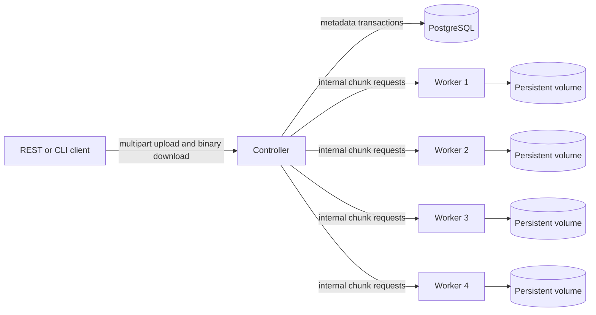

# System design

This document describes the implemented single-host object store. The [README](../README.md) covers setup and demonstration; the [CLI guide](cli.md) covers day-to-day commands.

## Architecture

The FastAPI controller owns object metadata, placement, reads, deletion, worker membership, and repair. PostgreSQL stores the authoritative metadata and repair state, not object bytes. Each worker stores chunk files and a local SQLite catalog in its own named volume. The controller is the only service published to the host, on `127.0.0.1:8000`. Worker and database traffic remains inside the Compose network.

The topology has one controller process and one process per worker volume. Controller object locks are process-local; adding controller replicas or extra Uvicorn workers would require distributed coordination.

## Storage rules

1. Chunk size is 1,000,000 bytes (decimal 1 MB). The final chunk may be smaller. An empty object has zero chunks and the SHA-256 digest of empty bytes.
2. Object and chunk IDs are separate UUIDs. A filename is display metadata, never a filesystem path; duplicate names are allowed.
3. Zero-based chunk positions preserve byte order. Downloads stream chunks in that order.
4. Normal operation targets two valid copies on distinct eligible workers. Temporary extra copies may exist during repair or reconciliation.
5. Upload publishes an object only after two durable worker acknowledgments per chunk. Partial uploads remain invisible to list, metadata, and download.
6. The controller's size and SHA-256 values are authoritative. Workers validate their local files and manifests, and the controller independently checks bytes returned by workers.
7. A replica destination is recorded before a network write. Uncertain replies therefore leave a durable target for later reconciliation or cleanup.

## Metadata model

| Table | Key fields | Role |
| --- | --- | --- |
| `objects` | UUID, name, size, content type, timestamps, SHA-256, chunk count, JSON custom metadata, lifecycle state | Object identity and visibility |
| `chunks` | UUID, object ID, position, size, SHA-256 | Ordered object content |
| `replicas` | Chunk ID, worker ID, state | Known and possible physical copies |
| `workers` | Worker ID, URL, storage and boot IDs, membership version, eligibility, heartbeat | Worker identity and availability |
| `repair_jobs` | Chunk ID, revision, reason, attempts, last error | Durable repair intent |
| `worker_operations` and `operation_clock` | Worker/chunk target and increasing sequence | Ordered mutations and retry protection |
| `damage_receipts` | Damage event ID | Deduplicated worker reports |
| `upload_receipts` | Idempotency key, fingerprint, object ID, state, response | Upload replay across restarts |

PostgreSQL migrations live in `migrations/` and run before the controller starts. Object states are `uploading`, `available`, and `deleting`. Replica states are `pending`, `healthy`, and `bad`. A `healthy` state records the latest successful verification or acknowledgment; it is not a continuous claim about disk contents. Reads and scans recheck integrity.

Each worker volume also contains a SQLite `catalog.sqlite` with trusted expected size/hash, mutation receipts, scan progress, and retained damage events. This is local worker state, not another service or a replacement for PostgreSQL.

## Client API

Structured responses use JSON. Binary downloads use the stored content type. Errors raised before streaming starts use `{"error":{"message":"..."}}`; validation errors may include `details`.

| Method | Path | Request and success response |
| --- | --- | --- |
| `POST` | `/api/v1/objects` | Multipart `file`, optional JSON-string `metadata`; 201 with object metadata |
| `GET` | `/api/v1/objects/{object_id}` | 200 binary, original content type, content length, checksum header |
| `GET` | `/api/v1/objects/{object_id}/metadata` | 200 with system metadata, chunks, replicas, and custom metadata |
| `PATCH` | `/api/v1/objects/{object_id}/metadata` | JSON string-to-string map; 200 updated metadata |
| `DELETE` | `/api/v1/objects/{object_id}` | 204 after logical deletion commits |
| `GET` | `/api/v1/objects?offset=0&limit=100` | 200 paginated object summaries |
| `GET` | `/api/v1/status` | 200 worker, cleanup, scan, and repair status |

Invalid requests return 400, missing or invisible objects return 404, conflicts return 409, unavailable required storage or metadata returns 503, and unexpected failures return 500. Keyed upload replay after deletion returns 410. Object IDs must be valid UUID strings. Custom metadata is limited to 100 string pairs, keys of 1–128 characters, and values of at most 2,048 characters. PATCH merges fields; it does not remove keys or rewrite object bytes.

## Internal API

| Receiver | Method and path | Purpose |
| --- | --- | --- |
| Controller | `POST /internal/workers/register` | Register a configured worker and its storage/boot identity |
| Controller | `POST /internal/workers/heartbeat` | Refresh availability and deliver damage reports |
| Worker | `PUT /internal/chunks/{chunk_id}` | Persist a chunk with expected checksum and operation sequence |
| Worker | `GET /internal/chunks/{chunk_id}` | Return a validated chunk; reject missing or corrupt data |
| Worker | `DELETE /internal/chunks/{chunk_id}` | Remove a replica; permanent deletion blocks later resurrection |
| Worker | `GET /internal/workers/{worker_id}/chunks` | Return inventory for reconciliation |
| Worker | `GET /internal/scan` | Return local scan progress and pending damage events |

Worker URLs are checked against the configured four-member allowlist. The internal API assumes a trusted local Compose network; it is not a public multi-tenant interface.

## Request lifecycle

### Upload

1. The controller bounds concurrent multipart ingestion to two requests, checks available spool space, and validates the file and custom metadata.
2. It creates an invisible `uploading` object, reads at most one chunk at a time, and records each chunk's position, size, and checksum.
3. Placement chooses eligible workers with distinct IDs, considering recorded load and reported free space. A `pending` destination is committed before each PUT.
4. A worker records the operation, writes a temporary file, flushes it, atomically renames it, and acknowledges the write. The controller verifies a returned copy before marking placement healthy.
5. When every chunk has two valid copies, the controller commits the `available` state and final object checksum. Failure or cancellation leaves durable cleanup work; no partial object becomes visible.

The whole upload is spooled to the controller's persistent `/tmp` volume by multipart handling. Object bytes are not stored in PostgreSQL. Empty objects are supported without creating an empty chunk.

### Download

The controller loads an available object's ordered chunks under its object lock, fetches and verifies the first chunk before sending a 200 response, then streams subsequent chunks. It tries another eligible recorded replica if a copy is missing or corrupt. A proven bad copy creates repair intent; a network error alone does not prove corruption.

The complete object is never assembled in memory. If all copies of a later chunk fail after response headers were sent, the stream ends early; clients must check length and SHA-256. The supplied CLI does this before publishing a downloaded file.

### Metadata update and deletion

PATCH, DELETE, downloads, and maintenance serialize per object. An in-progress download holds the object lock, so DELETE waits for that stream to finish or disconnect before committing logical deletion. After the 204 response, new public requests see 404. Physical deletion may continue while a worker is offline.

The controller tracks all possible worker destinations during cleanup. A worker records a durable permanent deletion marker before unlinking bytes and rejects later PUTs for that chunk ID. These markers prevent delayed writes from resurrecting a deleted object.

## Worker failure and recovery

Workers register at startup, then heartbeat every two seconds. The controller treats a worker as unavailable after a configurable timeout (10 seconds in Compose). Registration or a heartbeat after expiry moves its old replica states to pending verification. A restarted worker retains its volume identity but has a new boot ID; it is ineligible until inventory reconciliation and a current health probe complete.

The controller compares worker inventory with authoritative chunk metadata. It handles missing, damaged, extra, or orphaned files without treating an old or mismatched volume as a valid replacement. Reads can continue from another valid copy during a worker outage. Repair copies valid bytes to an eligible distinct worker and verifies the replacement before reducing surplus copies.

Maintenance runs periodically (three-second configured interval), but recovery is not a hard three-second deadline. Network timeouts and unavailable capacity can delay work. If no valid copy is reachable, repair remains queued and a new read returns 503 before streaming begins.

## Integrity and durable repair

Workers check local chunk size, manifest, and SHA-256 on read. A background scan checks up to 16 cataloged chunks per pass against trusted expected values; scan cursor and cycle progress survive restart. A damaged file produces a durable event ID. Events are sent with heartbeats until the controller commits a deduplicated receipt and repair intent, then acknowledges them. Old reports cannot invalidate a newer replacement.

Read failures, inventory findings, worker reports, and availability changes converge on one persistent repair job per chunk. A serial maintenance loop handles up to 32 jobs per pass. Jobs retain attempts and errors when a source or destination is unavailable. A repair checks that its object and revision are still current before publishing or trimming replicas. Deletion and repair share the object lock.

Mutations use increasing operation sequences stored by both controller and worker. Workers reject stale or conflicting requests, retain completion receipts for retries, and finish interrupted publication or deletion on startup. Permanent deletion markers remain authoritative even if a later PUT arrives.

## Upload idempotency

`POST /api/v1/objects` accepts an optional `Idempotency-Key` header of 1–128 ASCII letters, digits, dots, underscores, colons, or hyphens. The key is case-sensitive and scoped to this controller deployment. The fingerprint covers normalized filename, content type, custom metadata, exact size, and file SHA-256.

The first successful keyed upload returns 201 with `Idempotency-Replayed: false`. An identical retry returns the saved original response and object ID with `Idempotency-Replayed: true`, without rewriting workers. A changed request returns 409; a matching retry after deletion returns 410. A failed unpublished attempt can retry with the same key and payload. Receipts persist through controller restarts and remain after object deletion. They do not expire or provide resumable transfer: a retry resends the full file.

## Concurrency and resource limits

Per-object asyncio locks serialize lifecycle changes within the single controller process. A maintenance lock prevents overlapping passes. The controller admits two simultaneous uploads and four downloads. It uses bounded network timeouts and a 50 MB free-space guard during upload spooling. Synchronous metadata transactions are short and do not span worker HTTP requests, but database stalls can briefly block the event loop.

Memory use is bounded by chunk buffers for transfers; metadata and full worker inventories still grow with chunk count. The demo defaults to 100 MB plus a partial final chunk and accepts smaller rehearsals with `--size-mb 2`. Available disk capacity is the practical object-size limit.

## Operational boundaries

- One controller and one PostgreSQL instance are single points of failure. Two worker copies do not protect against losing both replicas or the physical host.
- Authentication, authorization, TLS, backup automation, and Internet-facing deployment are outside this local project.
- There is no object versioning, overwrite, range download, resumable upload, or distributed controller leader election.
- Worker catalogs, operation receipts, and permanent deletion markers are retained. Restore PostgreSQL metadata and worker volumes together; restoring an older controller database against newer worker sequence records is unsupported.
- A long client download can delay deletion and repair for that object. Full inventories and metadata responses are not optimized for millions of chunks.

## Verification

The automated suite in `tests/` covers chunk-size boundaries, REST contracts, membership, failures, corruption, lifecycle races, CLI behavior, and idempotency. Run it in Linux with `python -m pytest -q`. The guided `final_demo/demo.py` verifies the six-container deployment, physical replicas, worker stop/restart, corruption detection and repair, controller restart, and cleanup against the live Compose stack. See the [README demonstration steps](../README.md#run-the-demonstration).
